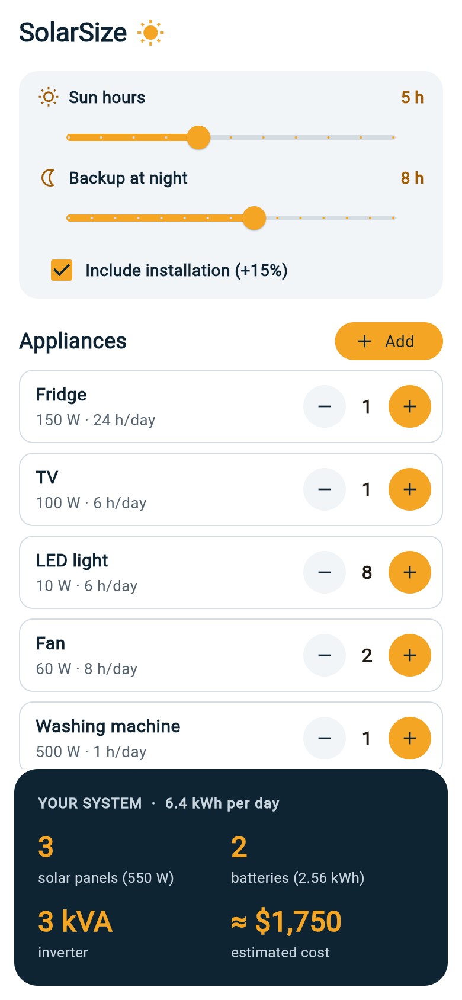
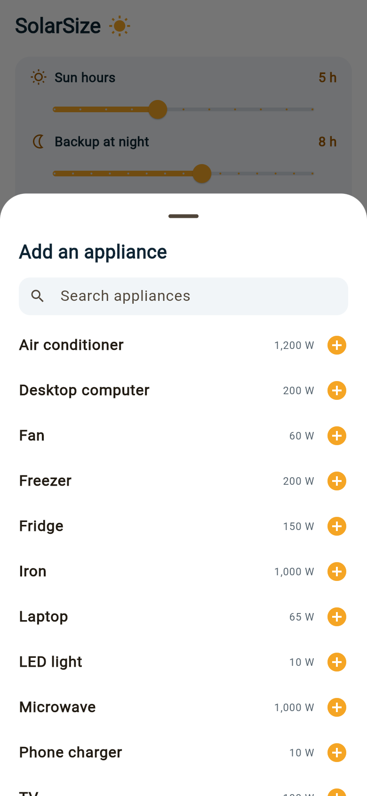
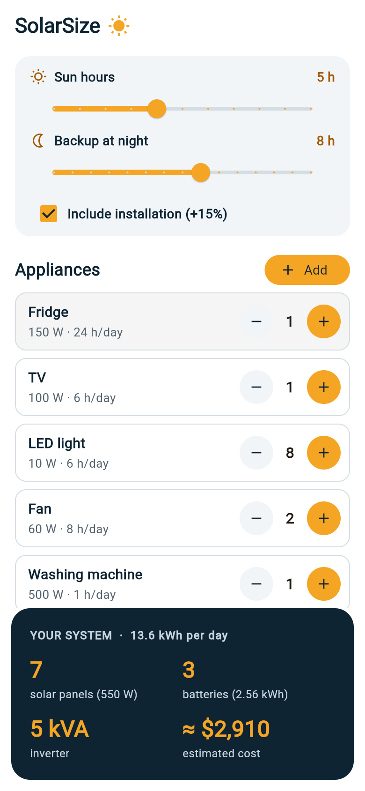
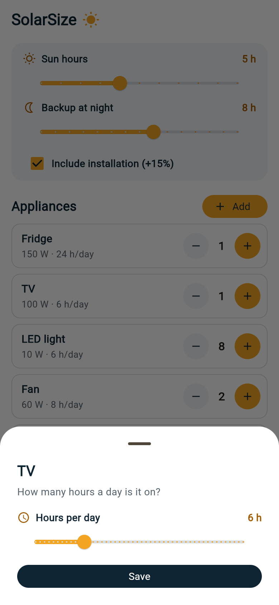
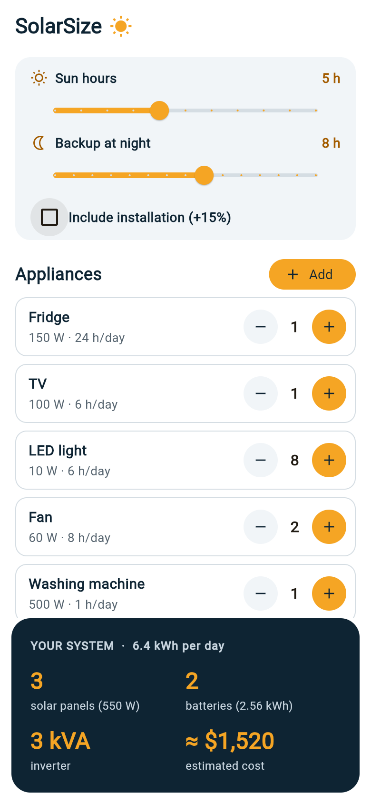

# SolarSize

A one-screen Flutter app that estimates the solar system a home needs.

Pick your appliances, set how many of each and how many hours a day they run,
then set the sun hours in your area and how many hours of battery backup you
need at night. The app shows the number of solar panels, the number of
batteries, the inverter size (kVA) and an estimated cost. Results update as
soon as anything changes.

CSCI410 Mobile Application, Project 1. Maryam Bazzal.

## Screenshots

| Main page | Add an appliance | Results update | Hours per day | Without installation |
| --- | --- | --- | --- | --- |
|  |  |  |  |  |

## How to run

```
flutter pub get
flutter run
```

Run the tests with `flutter test`.

## Project structure

| File | What it does |
| --- | --- |
| `lib/main.dart` | App entry point, opens the home page |
| `lib/home.dart` | The only page; holds the solar system and the callback functions |
| `lib/widgets.dart` | Slider, appliance tile, results card and the two bottom sheets |
| `lib/appliance.dart` | Appliance class, the catalog list and number formatting |
| `lib/solar_system.dart` | SolarSystem class that calculates panels, batteries, inverter and cost |
| `test/` | Unit tests for the calculation and widget tests for the page |

There is no database. The appliance catalog is a constant list in the code.

## How the calculation works

1. **Daily energy** = sum of watts x quantity x hours per day (Wh)
2. **Panels** = daily energy / (550 W x sun hours x 0.8), rounded up
3. **Batteries** = daily energy / 24 x backup hours / 0.8 / 2,560 Wh, rounded up
4. **Inverter** = total watts x 1.25 / 0.8 / 1000, rounded up to a standard
   size (1, 1.5, 3, 5, 8 or 10 kVA)
5. **Cost** = panels x $90 + batteries x $450 + inverter price, plus 15% if
   "Include installation" is checked

Panel size, battery size and prices are constants at the top of
`solar_system.dart`. They are rough estimates and can be changed there.
